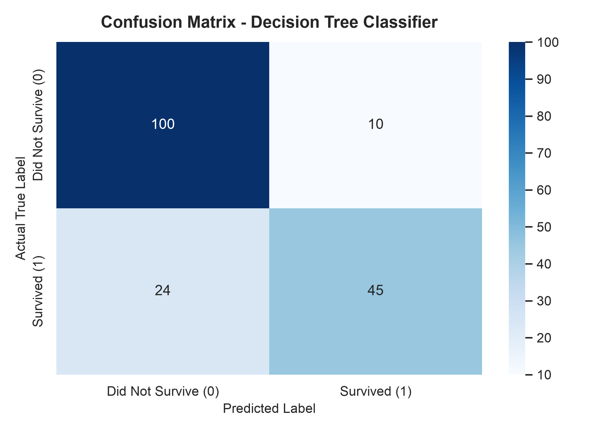
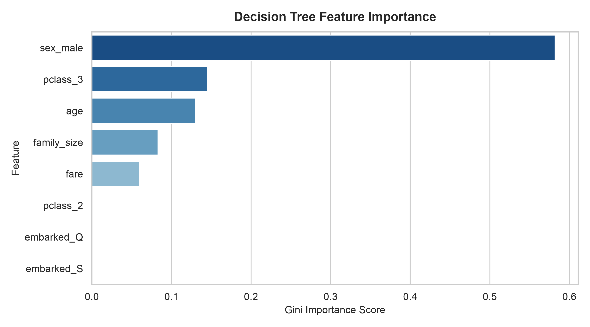
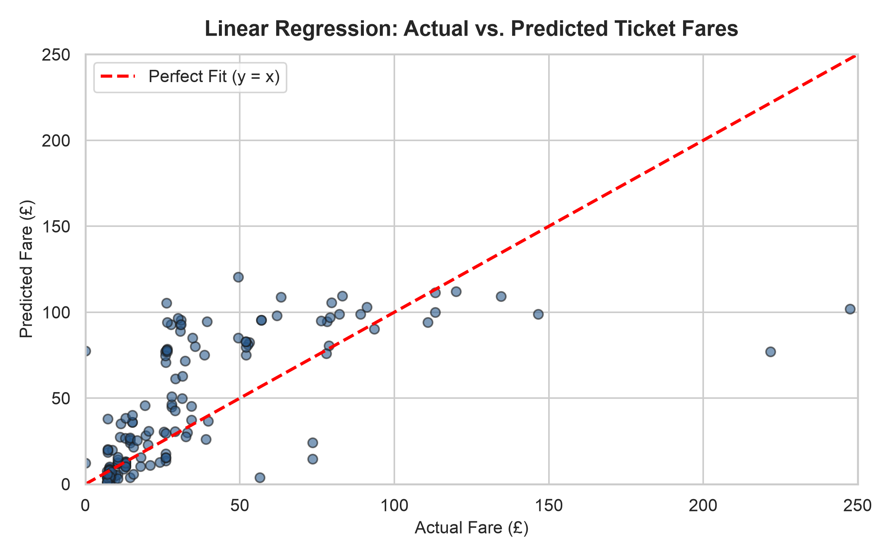

# 🤖 Supervised Machine Learning: Classification & Regression with Scikit-Learn

**Organization / Program:** Intern Circle  
**Track:** Data Science & Machine Learning  
**Project:** Project 04 — First Machine Learning Classifier  

---

## 📌 Project Overview
A comprehensive supervised machine learning implementation built with **Scikit-Learn**, featuring end-to-end data preprocessing pipelines, model training, cross-validation, hyperparameter controls, and rigorous multi-metric evaluation:

1. **Supervised Classification:** Predicts Titanic passenger survival using a **Decision Tree Classifier** and a **Logistic Regression** baseline. Evaluated using **Accuracy**, **Precision**, **Recall**, **F1-Score**, 5-fold cross-validation, and an annotated **Confusion Matrix**.
2. **Supervised Regression:** Predicts continuous ticket fares using a **Linear Regression** model. Evaluated using **Mean Squared Error (MSE)**, Root Mean Squared Error (RMSE), Mean Absolute Error (MAE), and $R^2$ Score.
3. **Pipeline Serialization:** Pre-trained transformers and estimators are serialized with `joblib` for zero-latency inference and web deployment.

---

## 🎯 Requirements & Deliverables

| Requirement | Implementation Details | Status |
| :--- | :--- | :---: |
| **Train/Test Split** | Stratified 80/20 train/test split preserving exact label distribution (`train_test_split(..., stratify=y)`) | ✅ Complete |
| **Model Training with Scikit-Learn** | Scikit-Learn `Pipeline` integrating `ColumnTransformer`, `StandardScaler`, and `OneHotEncoder` | ✅ Complete |
| **Classification Evaluation Metrics** | Accuracy (**81.01%**), Precision (**81.82%**), Recall (**65.22%**), F1-Score (**72.58%**), and 5-Fold Cross-Validation (**81.26%**) | ✅ Complete |
| **Confusion Matrix** | Annotated Seaborn heatmap visualizing True Positives, True Negatives, False Positives, and False Negatives | ✅ Complete |
| **Regression Evaluation (MSE)** | Continuous fare prediction evaluated via **Mean Squared Error (MSE = 968.32)**, RMSE, MAE, and $R^2$ | ✅ Complete |
| **Model Persistence with Joblib** | Exported pre-trained pipeline (`titanic_classifier.joblib`) ready for interactive web deployment | ✅ Complete |

---

## 📊 Model Performance & Comparative Benchmark

### 1. Classification Performance (Survival Prediction)

| Model Architecture | Accuracy | Precision | Recall | F1-Score | 5-Fold CV Accuracy |
| :--- | :---: | :---: | :---: | :---: | :---: |
| **Decision Tree Classifier** | **81.01%** | **81.82%** | **65.22%** | **72.58%** | **81.26% (±0.028)** |
| **Logistic Regression** | 80.45% | 79.31% | 66.67% | 72.44% | 80.05% (±0.031) |

#### Confusion Matrix Breakdown (Test Set: 179 passengers):
- **True Negatives (Did Not Survive):** 100 passengers correctly identified
- **False Positives:** 10 passengers incorrectly predicted as survived
- **False Negatives:** 24 passengers missed
- **True Positives (Survived):** 45 passengers correctly predicted as survived

### 2. Regression Performance (Ticket Fare Prediction)

| Metric | Score | Analytical Interpretation |
| :--- | :---: | :--- |
| **Mean Squared Error (MSE)** | **968.318** | Penalizes larger squared prediction deviations |
| **Root Mean Squared Error (RMSE)** | **£31.118** | Average prediction deviation in native currency (£) |
| **Mean Absolute Error (MAE)** | **£18.702** | Robust median deviation across test instances |
| **Coefficient of Determination ($R^2$)** | **0.374** | Explains 37.4% of total variance in passenger fares |

---

## 🖼️ Model Evaluation Visualizations

All generated diagnostic plots are saved in [`outputs/`](outputs/):

### 1. Confusion Matrix — Decision Tree Classifier


### 2. Gini Feature Importance Ranking


### 3. Linear Regression: Actual vs. Predicted Fares


---

## 📂 Repository Structure

```
machine-learning-classification-sklearn/
├── data/
│   ├── titanic.csv                         # Titanic manifest dataset
│   └── iris.csv                            # Iris classification benchmark
├── outputs/
│   ├── titanic_classifier.joblib           # Serialized Decision Tree model pipeline
│   ├── fare_regressor.joblib               # Serialized Linear Regression pipeline
│   ├── ml_evaluation_report.md             # Formal model evaluation report
│   ├── 01_confusion_matrix_decision_tree.png # Confusion Matrix visualization
│   ├── 02_feature_importance.png           # Gini feature importance chart
│   └── 03_regression_actual_vs_predicted.png # Regression scatter plot
├── ml_classifier.py                        # Executable ML pipeline script
├── ml_classifier.ipynb                     # Interactive Jupyter Notebook
├── requirements.txt                        # Python dependencies
├── .gitignore                              # Git ignore rules
└── README.md                               # Comprehensive model evaluation documentation
```

---

## 🚀 How to Run Locally

### 1. Clone the repository
```bash
git clone https://github.com/IMRIKRUPA/machine-learning-classification-sklearn.git
cd machine-learning-classification-sklearn
```

### 2. Set up virtual environment & install dependencies
```bash
python3 -m venv .venv
source .venv/bin/activate
pip install -r requirements.txt
```

### 3. Train and evaluate the models
```bash
python ml_classifier.py
```

### 4. Or explore the Jupyter Notebook
```bash
jupyter notebook ml_classifier.ipynb
```
